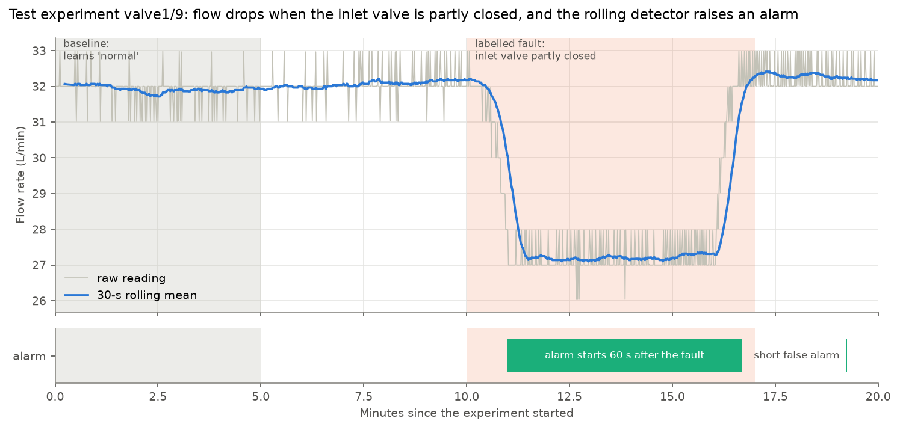

# Sensor Fault Detection & Maintenance Prioritisation

This project finds abnormal behaviour in multi-sensor time-series data from a water-pump testbed (the public SKAB dataset: vibration, motor current and voltage, flow, pressure and temperatures), using simple, explainable methods in Python. Each experiment learns its own "normal" from its first 5 minutes. Two detectors then raise alarms when sensors drift too far from it: a fixed threshold, and rolling statistics with a temperature rate-of-change rule. Settings were tuned on 24 experiments and **frozen before testing**. On the 10 held-out test experiments, the rolling detector caught **9 of 10 faults** (median delay about 1 minute), but **13% of normal running time was in alarm**, mostly in two files whose baselines were unreliable. The project ends with an alarm log and a label-free priority ranking for maintenance. It **detects anomalies; it does not predict equipment failure.**



## Key results (test set: 10 held-out experiments)

| | Rolling + rate detector (final) | "Flag everything" baseline | Rolling + rate on the tuning set (for reference) |
|---|---|---|---|
| Precision (share of alarm time that was really a fault) | **0.80** | 0.45 | 0.89 |
| Recall (share of fault time in alarm) | **0.63** | 1.00 | 0.45 |
| False-alarm rate (share of normal time in alarm, lower is better) | **13.0%** | 100% | 4.9% |
| Faults detected | **9 of 10** | 10 of 10 | 20 of 24 |
| Median detection delay | **67 s** | – | 25 s |
| False alarms per hour of normal running | **9.7** | – | 5.0 |

- **"Flag everything"** means being in alarm all the time. Its precision equals the share of test readings that are faults (45%), so that is the bar to beat, not zero.
- **Only 10 test files, so these numbers are uncertain.** One fault more or less moves the detection rate by 10 percentage points.
- **Where the false alarms came from:** 88% of the test false-alarm seconds come from the two cavitation files (other/12 and other/13).
- **Full analysis:** [reports/phase4_evaluation.md](reports/phase4_evaluation.md), which also covers the threshold detector and the version without the temperature rule.

## Method

1. **Data.** SKAB v0.9: 35 experiments on a laboratory water-pump loop, about 1 reading per second. 34 contain one deliberately caused fault; 1 is fault-free. Downloaded from the authors' GitHub repository and checked byte-for-byte against it.
2. **Cleaning.** Checks for unreadable timestamps, duplicates, missing values, physically impossible values, time gaps and label problems. Nothing is deleted or changed; problems are flagged in extra columns and every check is logged. Found: the same readings stored in two files (1,290 readings), 235 of which have contradictory labels.
3. **Split.** Whole files go to tuning (24) or test (10), about 30% test within each fault group, with a fixed random seed. Files that share readings are kept together. Decided before any detector existed.
4. **Baseline.** Each experiment learns every sensor's mean and spread from its own first 5 minutes.
5. **Detectors.**
   - **Threshold:** flags a reading more than k × its baseline spread from normal.
   - **Rolling statistics:** flags when the 30-second average moves too far, or the signal gets too jumpy.
   - **Temperature rule:** temperatures are watched through how fast they change, not their level.
   - **Persistence:** a flag only becomes an alarm after it stays on for 10 seconds.
6. **Tuning.** 212 detector settings plus 36 temperature-rule settings, tried on the tuning files only.
7. **Evaluation.** The frozen settings, scored on the 10 test files: per second (precision, recall, false-alarm rate), per fault (detected? how fast?) and per fault type, plus an analysis of every missed fault.
8. **Maintenance summary.** An alarm log with plain-English reasons, a priority ranking built from alarm duration, severity and number of sensors (no labels used), and a check of that ranking against the labels → [reports/maintenance_summary.md](reports/maintenance_summary.md).

## Key decisions and why

- **Baseline per experiment, not one global "normal".** The machine ran at three different operating points on different days: normal flow was about 127, 76 or 32 L/min. Limits learned from the fault-free run would have flagged every valve experiment from its first second.
- **Splitting by file, not by row.** Neighbouring readings are almost identical, so a random-row split would leak near-copies of test data into tuning. Files that share readings stay in the same set for the same reason.
- **Persistence rule (10 s).** Single odd readings are usually noise. Requiring a flag to last 10 seconds cut false alarms on the tuning set from 439 to 13, at the cost of every alarm starting at least 10 s late.
- **Temperatures by rate of change.** Temperatures drift slowly in normal running, so with level limits no setting got the false-alarm rate below 9.7%. A slow drift has a small rate; a sudden change has a large one.
- **Selection rule: cap false alarms first, then maximise recall.** At most 5% of normal time in alarm and at most 24 false alarms across 24 tuning files; then the highest recall. F1 was tried first but rewarded alarming almost all the time, because nearly half of the scored readings are faults.
- **Settings frozen before testing.** The test files weren't opened until Phase 4. The script checks that the settings match the tuned ones, and ideas that came from test results are listed as future work, not applied.

## Assumptions

- **Ground truth:** the `anomaly` column is the ground truth. Readings with contradictory labels in two files (235) are never scored.
- **Timing:** the sampling interval is about 1 second (the median gap). A gap over 2 s counts as missing readings; nothing is filled in. The timezone is unknown.
- **Physical limits:** vibration, flow, current and voltage can't be negative. Pressure can't be below a perfect vacuum (−1.01325 bar). Negative pressure is kept and flagged, because the docs don't say whether it is gauge or absolute pressure.
- **Labels for the fault-free file** are left empty, not set to 0, because the authors didn't give any.
- **Pressure is not used by the detectors.** It only takes about 10 distinct values, 0.328 bar apart.
- **Final settings:**
  - Rolling detector: 30-s window, level limit 5 × baseline spread, jumpiness limit 2 ×, temperature-rate limit 6 ×, persistence 10 s.
  - Threshold detector: limit 3 ×, temperature-rate limit 5 ×, persistence 10 s.
  - Everything looks only at past readings, so both could run live.
- **What counts as a detection:**
  - Scoring starts after each file's 5-minute baseline.
  - A fault counts as detected if an alarm overlaps its labelled period.
  - Under the stricter count, an alarm already running when the fault started only counts if it began at most 30 s before, lasted 10 s into the fault, and its sensors hadn't alarmed earlier. The result is 9 of 10 either way.
- **Maintenance ranking:**
  - Each run is monitored from the end of its baseline to the end of the file, for at most 20 minutes. That covers every fault run in full without favouring the 2.8-hour fault-free run.
  - Score = 100 × (share of time in alarm + log10(largest deviation) ÷ 2 + share of the 7 signals that alarmed) ÷ 3, built from alarms only.
  - With any one part weighted double, the top 5 keeps at least 4 of the same runs.
- **Documentation errors in SKAB:** where the SKAB documentation and the data disagree (file numbering, column names), the data files are taken as correct.

## Limitations

- **Laboratory testbed, induced faults, short runs** (about 20 minutes). Results may not carry over to machines in service, where faults develop naturally and slowly.
- **The test set is small: only 10 files.** Most fault types appear in only 1–2 test files, so all test numbers are uncertain.
- **Faults are far more common than in real life** (about 45% of scored readings). Real-world precision would be much lower for the same detector.
- **False alarms are too frequent for real use:** about 10 per hour of normal running on the test set.
- **A 5-minute baseline only stays valid for minutes.**
  - Over the full 2.8-hour fault-free run, the detectors are in alarm about 88% of the time as sensors slowly drift. A real system would need to re-learn its baseline.
  - If the first 5 minutes aren't normal (other/13), the whole run is misjudged.
- **Small changes are missed.** All missed faults are valve faults. There, flow moved by only about 2–5 × its normal spread, or crossed the limit only in 3–5 s bursts, too short for the 10-s persistence rule.
- **Temperatures are only watched through their rate of change,** so a slow, steady temperature fault would be missed. The temperature rule didn't clearly help on the test set: the same 9 faults were caught with and without it, and it added 3 false alarms.
- **The data has problems of its own.**
  - Overlapping files contain identical readings, some with contradictory labels.
  - Pressure readings are very coarse, and 7 are physically impossible (below vacuum).
  - Some fault types appear only in tuning or only in test.
- **The priority ranking shows how visible a fault was, not how serious it is.**
  - 34 of 35 runs contain a fault, so it can't show how well healthy runs are separated from faulty ones.
  - The one fault-free run ranks 19th of 35, because of drift alarms late in its window.
- **No failure prediction.** The labels mark anomaly periods, not failures or time-to-failure, so the project can't predict failures and doesn't claim to.

## Future work

These ideas came from looking at the test results, so they were deliberately **not** applied; testing them fairly needs new held-out data.

1. **Check the baseline before trusting alarms.** For example, require a minimum number of usable baseline readings and show a warning instead of alarms when it is too short (other/13 had 36 usable readings out of 300 s).
2. **A persistence rule that tolerates short breaks,** such as "flagged in at least 8 of the last 10 seconds". It would catch flow faults that cross the limit in 3–5 s bursts.
3. **Re-learn the baseline over time** for long runs, to stop slow drift from looking like a fault.
4. **Drop the temperature-rate rule or make it stricter.** It added false alarms on the test set without catching extra faults.
5. **Optional comparison with a machine-learning method** (Isolation Forest, scikit-learn) on a held-out test period, as planned for a final optional phase.

## How to run

Requires Python 3.14 (the version used here). From the project folder:

```bash
python3 -m venv .venv
.venv/bin/pip install -r requirements.txt
.venv/bin/python src/run_all.py
```

`run_all.py` runs every step in order and takes under a minute. It rebuilds `data/processed/skab_clean.csv`, which isn't stored in git because it is made from the raw data. All results, tables and figures are recreated exactly. Each step can also be run on its own, in the order listed in `src/run_all.py`.

## Project structure

```
data/raw/SKAB/              Original SKAB data, unchanged (35 CSV files + LICENSE + README)
data/processed/             Cleaned data (rebuilt), cleaning_log.csv, split.csv
src/
  common.py                 Shared paths, sensor names, units and figure style
  inspect_data.py           Phase 1: summary of the raw data
  clean_data.py             Phase 2: checks and flags; nothing deleted or changed
  make_split.py             Phase 2: tuning/test split by whole file
  explore_data.py           Phase 2: statistics and plots (tuning + fault-free files only)
  detectors.py              The detectors, persistence rule, alarm events and scoring
  tune_detectors.py         Phase 3/3b: tuning on tuning files, setting selection
  evaluate_test.py          Phase 4: frozen settings on the test files
  maintenance_summary.py    Phase 5: alarm log, priority ranking, sensitivity check
  make_headline_figure.py   The figure at the top of this README
  run_all.py                Runs everything in order
reports/
  maintenance_summary.md    One-page summary for a maintenance engineer
  phase2_findings.md        Which sensors change during faults
  phase3_detectors.md       Detector design, tuning and trade-offs
  phase4_evaluation.md      Test-set results and missed-fault analysis
  *.csv                     Every table behind the reports (alarm log, scores, rankings, ...)
figures/                    All plots (a–m) and the headline figure
notebooks/                  (empty; all analysis is in scripts)
```

## Data Sources, credit and licence

**Dataset:** SKAB, the Skoltech Anomaly Benchmark, v0.9
- **Authors:** Iurii D. Katser and Vyacheslav O. Kozitsin, Skolkovo Institute of Science and Technology (Skoltech), 2020
- **Official repository:** https://github.com/waico/SKAB
- **Dataset DOI (Kaggle):** https://doi.org/10.34740/KAGGLE/DSV/1693952
- **Downloaded:** 2026-10-14, from the `master` branch at commit `b2c0d46c2971dcbfe71e26087b6d231998bb91c2` (last updated 2024-08-11). All 35 CSV files were checked to be byte-identical to that commit.
- **What it contains:** sensors on a water-circulation loop driven by an electric motor and pump.
  - `valve1/` (16 files): partly closing the valve at the pump inlet.
  - `valve2/` (4 files): partly closing the valve at the pump outlet.
  - `other/` (14 files): leaks and additions, rotor imbalance, changes in water volume, cavitation and hotter water.
  - `anomaly-free/` (1 file): normal operation only.
- **Size:** 35 files, 46,806 rows in total.
- **Columns** (units from the SKAB README):
  - Accelerometer1RMS and Accelerometer2RMS (vibration, g)
  - Current (A), Voltage (V)
  - Pressure (bar)
  - Temperature (motor, °C), Thermocouple (fluid, °C)
  - Volume Flow RateRMS (L/min)
  - anomaly and changepoint labels (0/1)
- **Derived files:** everything in `data/processed/`, `figures/` and `reports/` is produced by `src/` from these raw files. `data/raw/` is never modified.

**Licences.**
- **The SKAB data** is licensed under the **GNU General Public License v3.0**. It is redistributed here unchanged, with its licence kept beside it at [`data/raw/SKAB/LICENSE`](data/raw/SKAB/LICENSE).
- **This repository** (code, reports and figures) is also released under **GPL-3.0** ([`LICENSE`](LICENSE)), so the two licences don't conflict. Copyright © 2026 Kimaya Manjkhola.
- **Credit:** please credit the SKAB authors when reusing the data.
