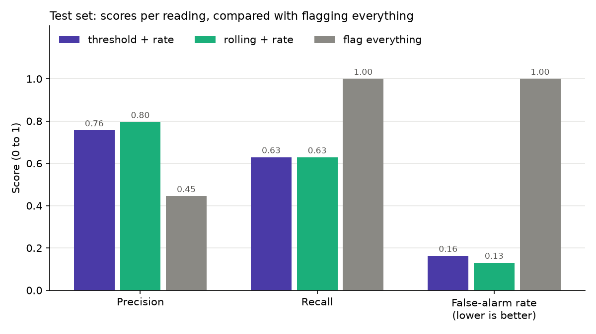
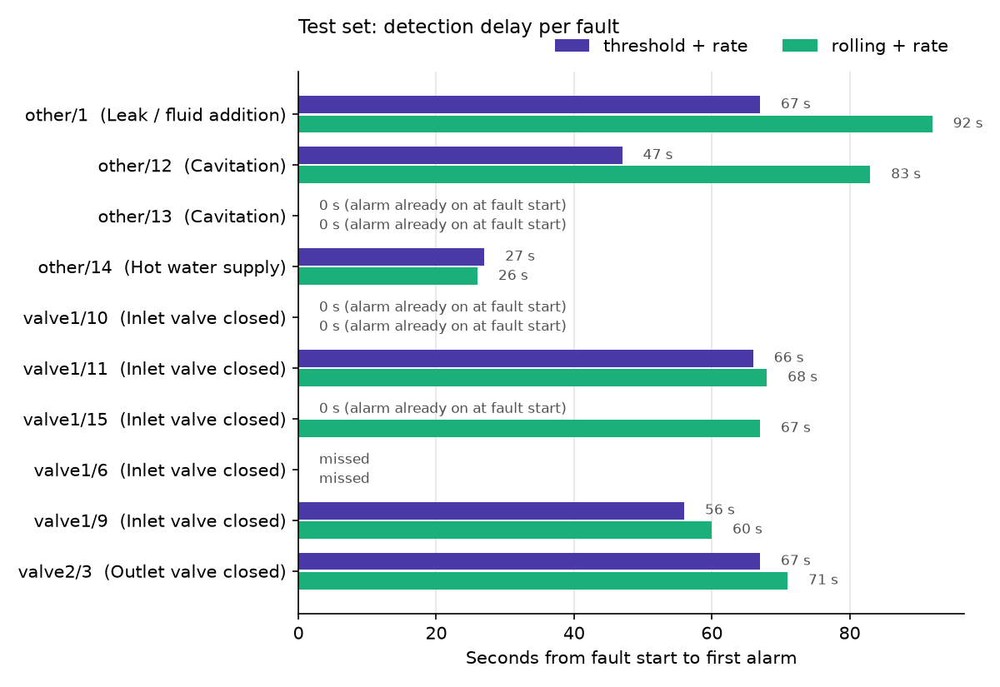
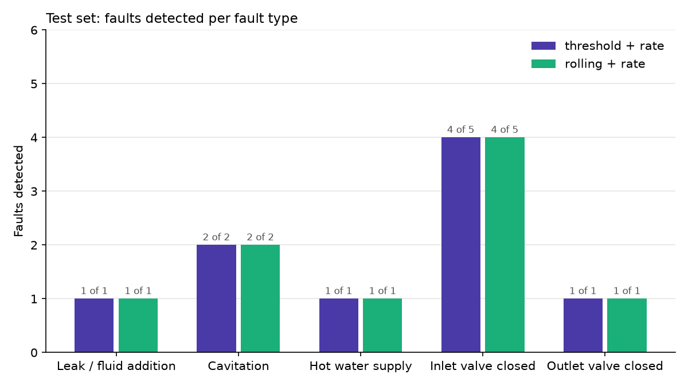

# Phase 4: evaluation on the held-out test set

> **Read this first: the test set has only 10 experiment files (10 faults), so these results are uncertain.** One fault caught or missed changes the detection rate by 10 percentage points. Most fault types appear in only 1 or 2 test files. The numbers below describe these 10 files. They are not a reliable estimate of how the detectors would perform on other faults or other machines.

**What was tested:** the final Phase 3b settings, unchanged, on the 10 test experiments that had not been used before.
- **Threshold + rate:** k = 3, N = 10 s, no temperature levels; temperature rate with W = 30 s, k = 5.
- **Rolling + rate:** 30 s window, k = 5, m = 2, N = 10 s, no temperature levels; temperature rate with W = 30 s, k = 6.
- The same two detectors **without** the temperature-rate rule were also run, to see whether Phase 3b's addition holds up on new data.

The script checks that these settings match Phase 3b before it runs. **No setting was changed after seeing test results.** Ideas for changes are listed only as suggestions in section 8.

**Made by:** `src/evaluate_test.py`. All numbers come from `reports/phase4_*.csv`. Tuning numbers were recalculated with the same code, and they match the Phase 3b report exactly.

**How scoring works:** same as in tuning. Only readings after each file's 5-minute baseline are scored. Readings with conflicting labels are never scored. This also applies when deciding whether an alarm counts as a fault alarm or a false alarm: an alarm that only touches conflicting readings counts as neither.

## 1. Test baselines (first 5 minutes)

`reports/phase4_baseline_check.csv`:

- **9 of 10 test files:** the baseline is fully labelled normal, with 282–288 readings and no gaps.
- **`other/13`: NOT fully normal.**
  - **Conflicting readings:** 178 of its 214 baseline readings are the conflicting ones. They are labelled normal in other/13 but anomaly in other/12, because both files contain the same readings (Phase 2).
  - **Gaps:** the baseline also has 26 gaps longer than 2 s.
  - **What the baseline is left with:** the method leaves conflicting readings out, so this baseline is learned from only **36 readings** (262–299 s). The first 4 minutes of other/13 are the end of other/12's cavitation (flow about 20 L/min), and those 36 readings come from the period when flow was still recovering. Baseline flow mean is 120.6 L/min (std 0.65).
  - **Not fixed:** as agreed, the method was not changed. Section 5 shows the effect.

## 2. Reading-by-reading scores (test set)

| | Precision | Recall | False-alarm rate |
|---|---|---|---|
| **Threshold + rate** | **0.76** | **0.63** | **16.3%** |
| **Rolling + rate** | **0.80** | **0.63** | **13.0%** |
| Threshold (no rate) | 0.77 | 0.62 | 14.8% |
| Rolling (no rate) | 0.80 | 0.61 | 12.4% |
| Flag everything | 0.45 | 1.00 | 100% |

**"Flag everything"** means being in alarm all the time. Its precision (0.45) is the share of scored test readings that are labelled anomaly. Both detectors are clearly more precise than that, but 0.45 is the bar they have to beat, not zero.

## 3. Per-fault scores (test set)

| | Threshold + rate | Rolling + rate |
|---|---|---|
| Faults detected, counting all alarms | **9 of 10** | **9 of 10** |
| Faults detected, strict count (see 3b) | **9 of 10** | **9 of 10** |
| Median delay, counting all alarms | 47 s | 67 s |
| Median delay, strict count (see 3b) | 56 s | 67 s |
| Separate false alarms | 10 | 11 |
| Normal running scored | 1.14 h | 1.14 h |
| **False alarms per hour of normal running** | **8.8** | **9.7** |

Per fault (`reports/phase4_per_fault.csv`); delay = seconds from fault start to first alarm:

| Fault | Type | Threshold + rate | Rolling + rate | Sensors in the fault alarms (threshold / rolling) |
|---|---|---|---|---|
| other/1 | Leak / fluid addition | 67 s | 92 s | flow / flow |
| other/12 | Cavitation | 47 s | 83 s | flow / flow |
| other/13 | Cavitation | 0 s* | 0 s* | vibration 1, flow / vibration 1, flow |
| other/14 | Hot water supply | 27 s | 26 s | fluid-temp. rate, flow / vibration 1, fluid-temp. rate, flow |
| valve1/6 | Inlet valve closed | **missed** | **missed** | – |
| valve1/9 | Inlet valve closed | 56 s | 60 s | flow / flow |
| valve1/10 | Inlet valve closed | 0 s* | 0 s* | vibration 2, motor-temp. rate, flow / motor-temp. rate, flow |
| valve1/11 | Inlet valve closed | 66 s | 68 s | flow / flow |
| valve1/15 | Inlet valve closed | 0 s* | 67 s | motor-temp. rate, flow / flow |
| valve2/3 | Outlet valve closed | 67 s | 71 s | flow / flow |

\* **0 s means an alarm was already running when the fault started.** Section 3b checks each case. Only valve1/10 counts as a genuine early catch; other/13 and valve1/15 are still detected, but by later alarms (20 s and 63 s).
- In **other/13**, the alarm comes from the weak baseline (section 1).
- In **valve1/10** and **valve1/15**, a temperature-rate alarm started shortly before the fault.
- Without the rate rule, the threshold detector's delays for these two were 82 s and 63 s.

## 3b. The "0 s" detections: early catch or artefact?

Three test faults had an alarm **already running** when the labelled fault started. None of the tuning faults did.

**The rule for counting such an alarm as a genuine early catch.** It was set before looking at the temperature traces, and is now calculated in `src/evaluate_test.py`. All three conditions must hold:
1. The alarm started **at most 30 s before** the labelled fault.
2. It kept going **at least 10 s into** the fault, so the change carried on into the fault.
3. **None of its sensors had raised an earlier alarm** in that file's normal running. Otherwise it looks like that sensor's normal noise.

**Strict count:** a fault counts as detected if it has a justified early catch, or an alarm that **starts** at or after the fault start.

| Fault | Detector | Alarm running at fault start | Started | Verdict | Why (from the data) | Strict result |
|---|---|---|---|---|---|---|
| other/13 | both | flow | 266 s before (threshold), 245 s before (rolling) | **Not an early catch: bad baseline** | The baseline was learned from 36 readings while flow was still recovering (120.6 L/min, section 1). Normal flow afterwards (124–125 L/min) is beyond the limit, so the alarm runs through normal running. | Still detected: a new alarm (vibration 1 + flow) starts **20 s** into the fault, when flow collapses (to an average of about 49 L/min over that minute) |
| valve1/10 | both | motor-temperature rate | 11 s before (threshold), 4 s before (rolling) | **Justified early catch** | Motor temperature starts falling at about 560 s and keeps falling into the fault (69.9 → 66.4 °C by 620–640 s). Its rate peaks at 8 baseline std inside the fault. Before 560 s, normal running never exceeded 3.6 std, and there was no earlier motor-temperature alarm. The same kind of drop was seen at fault onset in valve1/0 (Phase 2). | Detected, delay **0 s** |
| valve1/15 | threshold only | motor-temperature rate | 8 s before | **Not counted as an early catch** | Motor temperature was already falling from about 500 s, more than 90 s before the fault (69.2 → 65.4 °C), and had caused an earlier false alarm on the same signal (536–558 s). The data can't tell us whether this cooling was part of the fault. | Still detected: a flow alarm starts **63 s** into the fault |

**Result:** the strict count gives the same number of detected faults as counting all alarms: **9 of 10** for both detectors. Only the delays change. The threshold detector's median delay rises from 47 s to 56 s; the rolling detector's stays at 67 s. Per-fault details are in the `detected_strict`, `delay_strict_s` and `early_*` columns of `reports/phase4_per_fault.csv`.

**Caveat:** "justified" means the data is consistent with an early sign of the fault. It doesn't prove the fall in valve1/10's temperature was caused by the fault; the labels may simply mark the start slightly late or early.

## 4. Results per fault type (test set)

`reports/phase4_by_fault_type.csv`:

| Fault type | Faults | Threshold + rate: detected | Rolling + rate: detected | Median delay (thr. / roll.) | False alarms in these files (thr. / roll.) |
|---|---|---|---|---|---|
| Leak / fluid addition | 1 | 1 | 1 | 67 s / 92 s | 0 / 0 |
| Cavitation | 2 | 2 | 2 | 23.5 s / 41.5 s | 5 / 5 |
| Hot water supply | 1 | 1 | 1 | 27 s / 26 s | 0 / 1 |
| Inlet valve closed | 5 | 4 | 4 | 28 s / 63.5 s | 5 / 5 |
| Outlet valve closed | 1 | 1 | 1 | 67 s / 71 s | 0 / 0 |

- **Cavitation and hot water supply were not in the tuning set at all**, and both were detected. Mostly that was through flow; for hot water, also the fluid-temperature rate.
- **Most types have only 1 or 2 test faults,** so "1 of 1" is not strong evidence of anything.

## 5. Tuning vs test

| | Threshold + rate: tuning | Threshold + rate: test | Rolling + rate: tuning | Rolling + rate: test |
|---|---|---|---|---|
| Precision | 0.90 | 0.76 | 0.89 | 0.80 |
| Recall | 0.49 | **0.63** | 0.45 | **0.63** |
| False-alarm rate | 5.0% | **16.3%** | 4.9% | **13.0%** |
| Faults detected | 19 / 24 (79%) | 9 / 10 (90%) | 20 / 24 (83%) | 9 / 10 (90%) |
| Median delay | 49 s | 47 s | 25 s | 67 s |
| False alarms per hour of normal running | 7.3 | 8.8 | 5.0 | 9.7 |
| "Flag everything" precision | 0.47 | 0.45 | 0.47 | 0.45 |

### In plain language: what changed and why

**Catching faults did not get worse; it got slightly better.**
- 9 of 10 test faults were caught, compared with about 80% in tuning, and recall rose from about 0.47 to 0.63.
- The main reason: in 4 of the 5 test inlet-valve files, 71–76% of the fault seconds were in alarm. Across the 11 tuning inlet-valve files only 38% were, and 4 of them were missed completely.
- So the test valve faults happened to be easier to see. With only 5 test valve files, this is luck of the draw as much as anything. It doesn't show that the detector got better.

**False alarms got clearly worse.**
- The false-alarm rate is about three times higher (5% → 13–16%), and precision fell from about 0.90 to about 0.76–0.80.
- **This comes almost entirely from the two cavitation files.** other/12 and other/13 produce 519 of the threshold detector's 667 false-alarm seconds (78%) and 466 of the rolling detector's 532 (88%), nearly all on flow:
  - **other/13:** the baseline was learned from 36 readings taken while flow was still recovering from the previous experiment (120.6 L/min). Normal flow afterwards is about 124–125 L/min, roughly 6–7 baseline standard deviations higher. So the detectors are in alarm through most of the normal running.
  - **other/12:** flow drops from about 126.9 to about 125.2–125.9 L/min around 5 minutes *before* the labelled anomaly starts. After the anomaly it only recovers to about 124.4 L/min. Both stretches are labelled normal, so alarms there count as false. The SKAB documentation doesn't say whether the early drop is part of the "draining until cavitation" process, so we don't claim it is.
- **Without those two files**, the test false-alarm rate would be about 4.6% (threshold) and 2.1% (rolling), similar to tuning. This only explains *where* the false alarms came from. It does **not** replace the official test result above, because those two files are a legitimate part of the test set.

**False alarms per hour are high in both sets** (5–10 per hour of normal running). On a real machine that would be far too many. Part of this is because each experiment is short and starts with only 5 minutes of baseline.

**Did the temperature-rate rule (Phase 3b) help on the test set?** Not clearly.
- Both versions caught the same 9 faults.
- With the rule: recall was only slightly higher (+0.011 threshold, +0.015 rolling), there were 3 more false alarms each, and the false-alarm rate was higher.
- In other/14 (hot water) the rule did raise alarms through the fluid-temperature rate, but the fault was caught through flow anyway.

## 6. Missed faults: what changed, and why it wasn't enough

`reports/phase4_missed_fault_analysis.csv` compares each signal during the fault with the same file's baseline. Everything is in **baseline standard deviations (std)**, the same unit the detectors use.

**What each detector needs before it alarms:**
- **Threshold detector:** a reading beyond **3 std**, staying there for at least **10 s without a break**.
- **Rolling detector:** a 30-second average beyond **5 std**, or a 30-second std above **2×** the baseline std, for 10 s.
- **Temperature rate:** above **5 std** (threshold detector) or **6 std** (rolling detector), for 10 s.

| Fault (set) | Missed by | Biggest change seen | Why it wasn't enough (from the data) |
|---|---|---|---|
| **valve1/6 (test)** | both | Flow: average −2.0 std; largest 30-s average 3.3 std | Only 3% of fault readings were beyond 3 std, never more than 1 s in a row. The 30-s average never reached 5 std. Temperature rates peaked at 1.1 and 1.9 std. **The change was too small compared with normal noise.** |
| **valve1/1 (tuning)** | both | Flow: average −3.1 std; 31% of readings beyond 3 std; largest 30-s average 4.1 std | Readings beyond 3 std were scattered: **never more than 3 s in a row**, so the 10-s persistence rule never fired. The 30-s average stayed below 5. The fluid-temperature rate peaked at 4.5 std, just under 5. |
| **valve1/2 (tuning)** | both | Motor-temperature rate up to 6.1 std | It stayed above 5 std for **8 s at most** (10 s needed). Flow barely changed (−0.9 std). |
| **valve1/4 (tuning)** | both | Flow: average −1.8 std; largest 30-s average 2.1 std | No reading beyond 3 std at all. Rates peaked at 1.3 and 2.4 std. **The change was too small.** |
| valve1/3 (tuning) | rolling only | Flow: largest 30-s average **4.95 std** | Just under the rolling detector's k = 5. (The threshold detector caught it: flow stayed beyond 3 std for 15 s.) |
| valve1/8 (tuning) | threshold only | Flow: 57% of readings beyond 3 std | Never more than **5 s in a row**, so persistence never fired. (The rolling detector caught it.) |
| valve2/2 (tuning) | threshold only | Flow: 35% of readings beyond 3 std | Never more than **4 s in a row**. (The rolling detector caught it.) |

**The pattern:**
- Every missed fault is a **valve** fault, and in all but valve1/2, **flow** is the main signal that changes.
- In **three** of them (valve1/6, valve1/4 and valve1/2) the change is simply small compared with normal noise. In valve1/2, flow barely moves and only the motor-temperature rate briefly passes its limit.
- In **the rest**, flow does move clearly, but in short bursts. The readings keep returning inside the limit, so the 10-second persistence rule keeps restarting. The rolling average smooths this out, which is why the rolling detector caught valve1/8 and valve2/2.

## 7. What these results do and don't show

- **Small test set, so uncertain results:** only 10 test files (10 faults), most fault types with 1–2 files. One more or one fewer caught fault changes the detection rate by 10 percentage points. The test results should be read as "how it went on these 10 files", not as a reliable performance figure.
- **Precision is inflated:** 45% of scored test readings are anomalies, far more than on a real machine. On real equipment, where faults are rare, the same false alarms would make precision much lower.
- **Both detectors show the same pattern:** they reliably catch faults that change flow or vibration strongly. They miss small flow changes, and they produce many false alarms when the baseline is unrepresentative (other/13) or when flow doesn't return to its starting level (other/12).
- **This is anomaly detection, not failure prediction.** An alarm means "readings differ from this run's first 5 minutes". It says nothing about when, or whether, equipment will fail.

## 8. Suggestions (NOT applied; noted for possible future work)

These came from looking at test results, so applying them now would make the test set no longer independent. Any of them would need a new held-out set to evaluate fairly.

1. **Check that the baseline is usable before trusting a file's alarms.** For example, require a minimum number of usable baseline readings, and show a warning instead of alarms when the baseline is too short. In other/13 only 36 of 300 s were usable.
2. **A persistence rule that tolerates short breaks**, such as "flagged in at least 8 of the last 10 seconds" instead of "10 seconds without a break". In valve1/1, valve1/8 and valve2/2, flow readings beyond the limit came in bursts of 3–5 s.
3. **Re-learning the baseline over time,** for long runs. This was already noted in Phase 3 (the anomaly-free run is in alarm 88–89% of the time over 2.8 h).
4. **Drop the temperature-rate rule or make it stricter.** It added false alarms on test without catching any extra faults. That shows on only 10 files, though.
